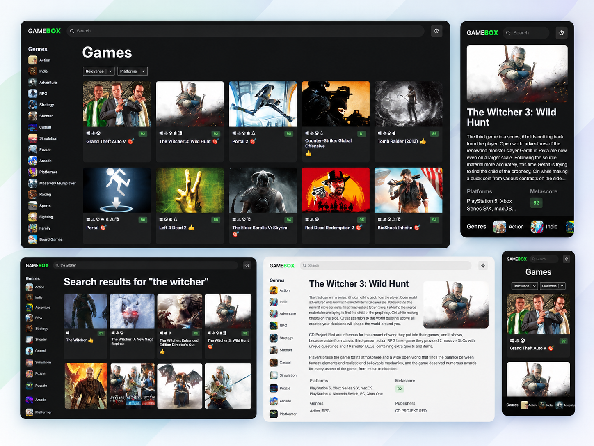

# GameBox 🎮

A [RAWG.io](https://rawg.io/)-inspired **game discovery app** that lets users browse, search, filter, sort, and view details for video games across genres and platforms, with dark/light theme support and a responsive, accessible layout.

GameBox is built with **React and TypeScript**, using **Zustand for client-side browsing state**, **TanStack React Query for server state and caching**, **React Router for navigation and URL-based search**, and the **RAWG API** for game data.

Live demo: https://game-box-omega.vercel.app

## Preview



## Features

- **Search** games by name
- **Filter** by genre and platform
- **Sort** games by different criteria
- **Game detail pages** with dynamic routes
- **URL-based search queries** that persist across refresh and browser navigation
- **Dark / Light theme toggle** persisted in localStorage
- **Responsive and accessible UI** across devices
  - Desktop: sidebar genre list
  - Mobile: bottom horizontal genre list
- **Loading skeletons** for better UX
- **Load more pagination** with retry support that preserves existing results
- **Error handling** for initial loading and pagination failures
- **Request cancellation** for game requests that are no longer needed

## Tech Stack

- React
- TypeScript
- Vite
- React Router
- Zustand
- TanStack React Query
- Axios
- RAWG Video Games Database API
- CSS Modules
- react-loading-skeleton
- Fontsource (self-hosted fonts)
- Vitest, React Testing Library, and MSW

## Local Setup

1. Install dependencies:

   ```bash
   npm install
   ```

2. Copy `.env.example` to `.env.local`.

3. Replace the placeholder in `.env.local` with your RAWG API key:

   ```dotenv
   VITE_RAWG_API_KEY=paste_your_existing_key_here
   ```

   You can obtain a key from [RAWG](https://rawg.io/apidocs).
   `.env.local` is ignored by Git and should not be committed.

4. Start the development server:

   ```bash
   npm run dev
   ```

   Restart the server after changing environment variables.

### Deployment

Set `VITE_RAWG_API_KEY` in your hosting provider's environment
variables before building the app. Redeploy after changing its value.

Vite exposes `VITE_` variables to the browser. This configuration
keeps the key out of source files but does not make it private.

## Architecture & Key Concepts

- **React Router** for page navigation, nested routes, dynamic game routes, and URL search parameters
- **Layout and Outlet** for shared navigation and page-level content
- **Custom hooks** (`useGames`, `useGame`, `useGenres`, `usePlatforms`) to encapsulate data-fetching logic
- **Reusable API client** for collection and single-resource requests
- **Type-safe data handling** with shared TypeScript interfaces
- **Reusable components** with CSS Modules and theme-aware variables

### State Management Decisions

GameBox uses different approaches depending on the type of state:

- **TanStack React Query** manages server state, including fetching, caching, pagination, and request lifecycle.
- **Zustand** manages shared browsing state such as selected genre, platform, and sort order.
- **URL search parameters** are the source of truth for search queries, allowing searches to persist across refreshes and browser navigation.
- **localStorage** is used to persist the user's theme preference.

For an application of this size, the browsing filters and sort state could also be stored in URL search parameters. I chose Zustand partly to explore a lightweight global state-management approach and to separate client state from server state managed by TanStack Query.

If I were evolving the application further, I would consider moving more browsing state into the URL so filtered views could be shared, bookmarked, and restored directly.

## Testing

GameBox uses Vitest, React Testing Library, and MSW for integration testing, covering key user flows, loading and error states, pagination, and navigation.

Run the tests:

```bash
npm run test:run
```

## Performance

GameBox achieves Lighthouse Performance scores of **98 on desktop** and **83 on mobile**.

### Lighthouse Results

| Metric                         | Mobile | Desktop |
| ------------------------------ | -----: | ------: |
| Performance Score              | **83** |  **98** |
| First Contentful Paint (FCP)   |  1.8 s |   0.4 s |
| Largest Contentful Paint (LCP) |  4.1 s |   1.1 s |
| Total Blocking Time (TBT)      | 170 ms |   10 ms |
| Cumulative Layout Shift (CLS)  |      0 |       0 |

_Results are from individual Lighthouse audits and may vary with network conditions, device simulation, and external API response times._

### Performance Considerations

- **Image loading:** Prioritises the first game-card image using `loading="eager"` and `fetchPriority="high"`, while lazy-loading subsequent images.
- **Font loading:** Self-hosts fonts using Fontsource instead of loading them through Google Fonts, eliminating the external stylesheet request.
- **External images:** Game images are served by RAWG, limiting direct control over image formats, sizes, and compression. Further optimisation through a CDN or image proxy remains an option, subject to additional complexity and RAWG's usage terms.

## Project Structure (Simplified)

```text
src/
├── assets/       # images and media
├── components/   # reusable UI and container components
├── hooks/        # custom data-fetching hooks
├── pages/        # route-level pages
├── services/     # API client and utilities
├── test/         # test setup and API mocks
├── store.ts      # Zustand browsing state
├── App.tsx       # shared application layout
├── main.tsx      # app entry point and routing
└── types.ts      # shared TypeScript types
```
